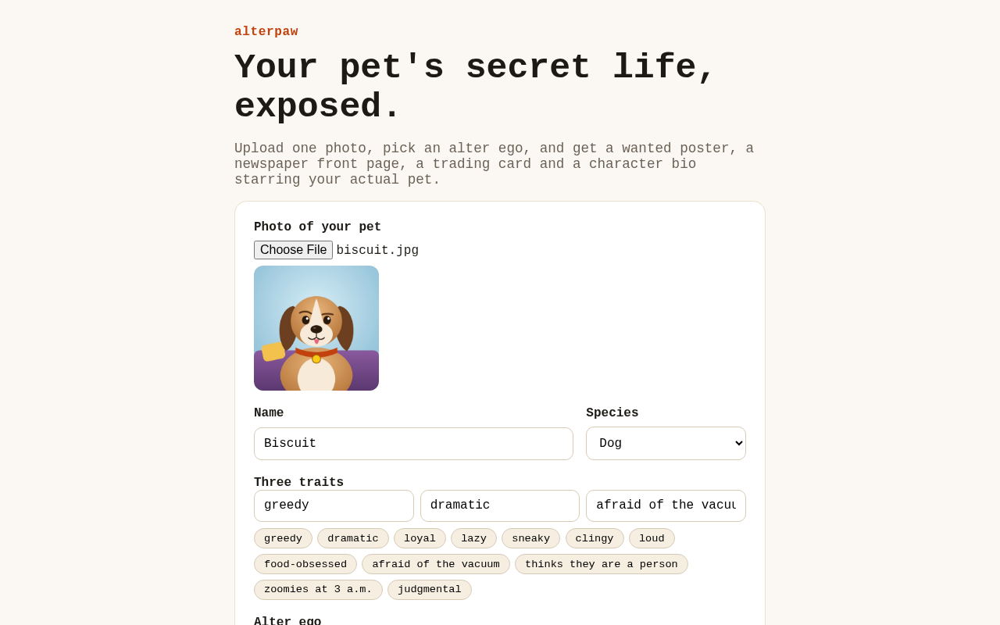
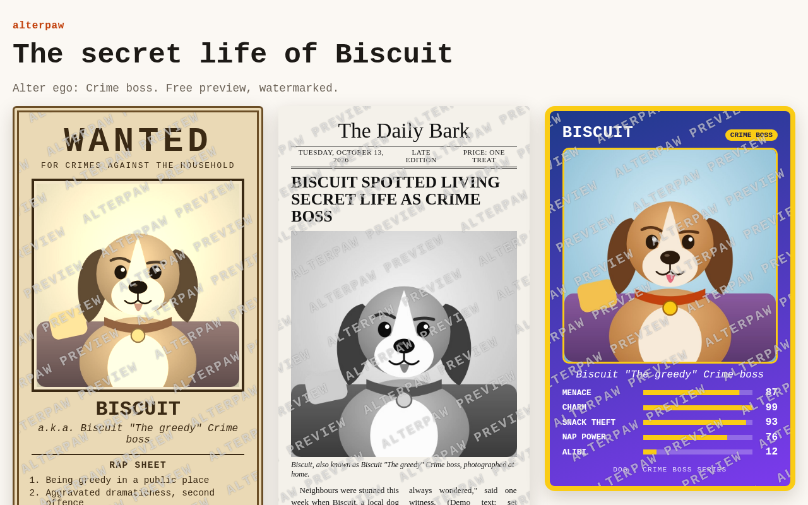
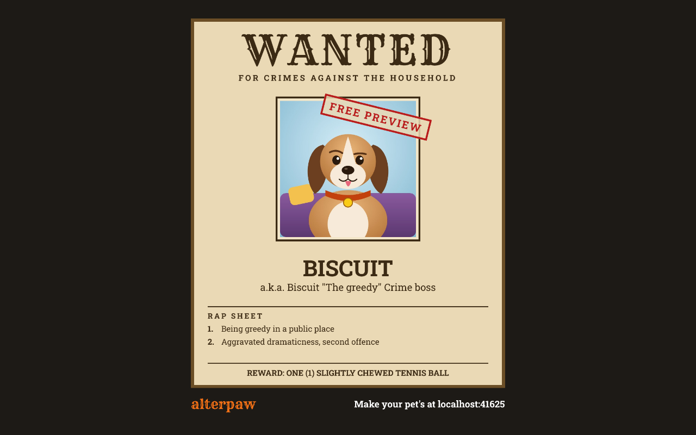
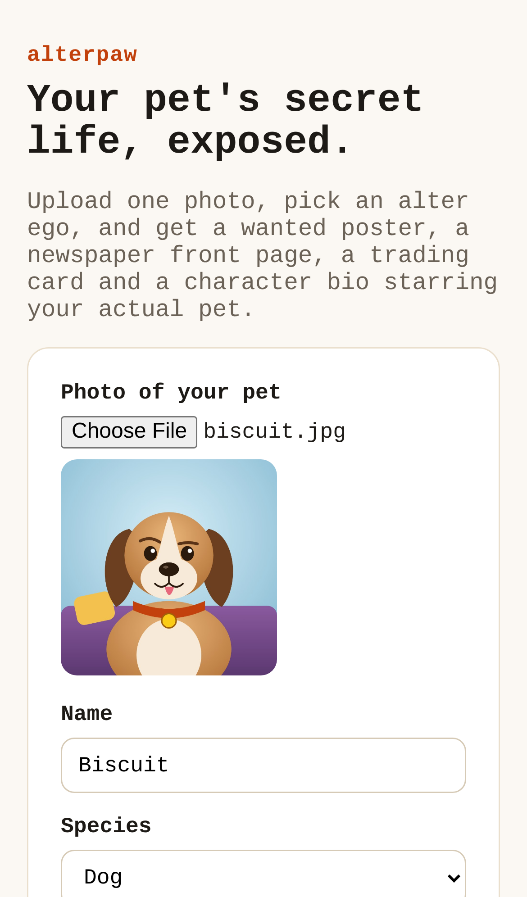
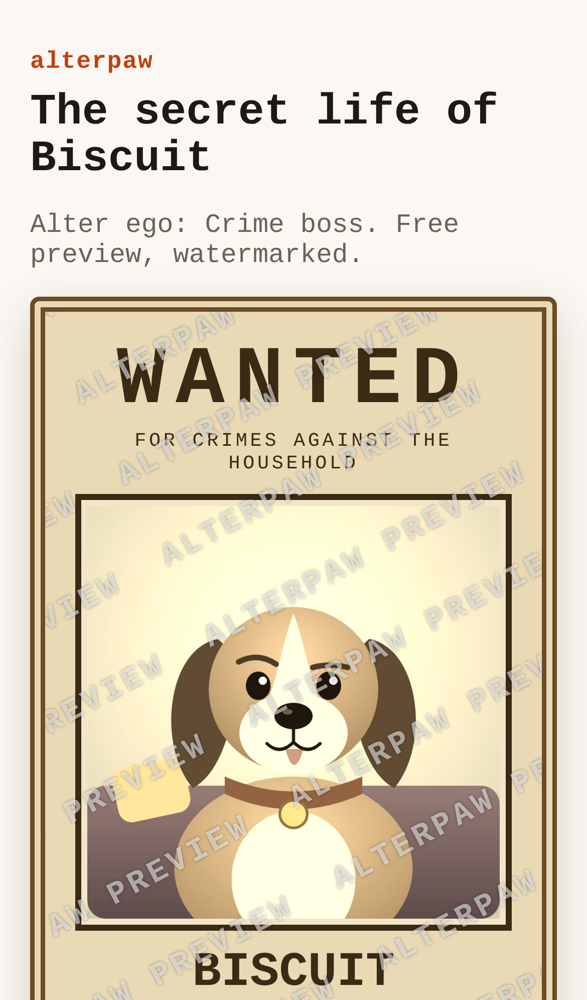
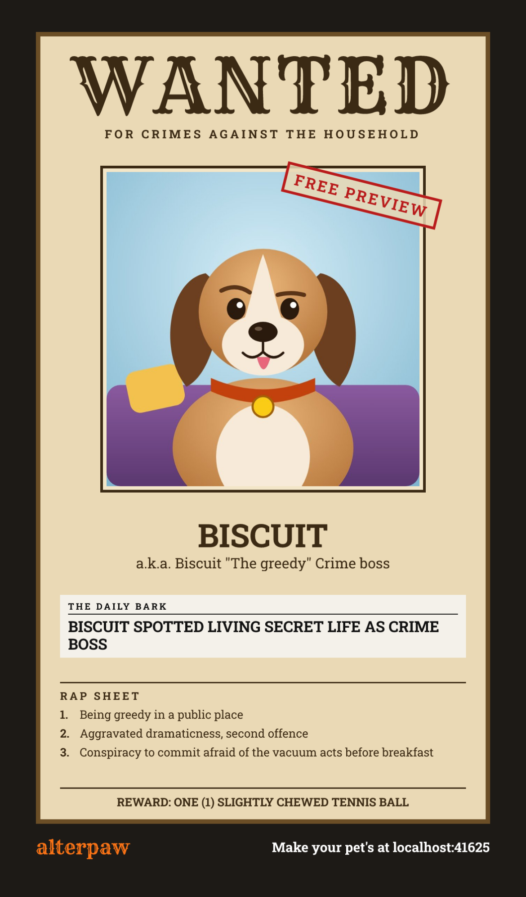

# alterpaw — your pet's secret life, as a funny wanted poster, newspaper and trading card

## Screenshots

The start page takes a photo (shrunk in the browser, preview shown), a name, species, three traits and an alter ego.

Submitting the form generates the character and opens the watermarked preview with all the cards, built from the uploaded photo.

The share link returns a 1080×1350 wanted-poster PNG, rendered on the server with the pet's photo.

On a phone the same form stacks into one column, and the chosen photo shows before upload.

The full upload-and-generate flow also works on a phone, and the cards stack one per row.

The 1080×1920 Stories/Reels/TikTok version adds the newspaper headline and the full rap sheet.

_Made by `npm run screenshots` with a drawn sample dog and the app's offline demo writer (no database, no model call), so the jokes are canned text, not the real model's. The UI font is the sandbox Chromium's fallback; phones and desktops use their own system font._

For pet owners and the friends who buy them gifts, it turns one pet photo into a funny alter-ego bundle (wanted poster with rap sheet, newspaper front page, trading card, bio) for $9–$20 instead of a slow $17–$45 Etsy order.

- [Research](RESEARCH.md) — findings and sources
- [PRD](PRD.md)
- [Roadmap](ROADMAP.md)

Effort: Low · Confidence: Low

_Researched by the idea pipeline on 2026-10-13 ([original record](https://github.com/smithdavedesign/idea-factory/tree/main/ideas/alterpaw)); repo created on David's go-ahead 2026-10-13._
