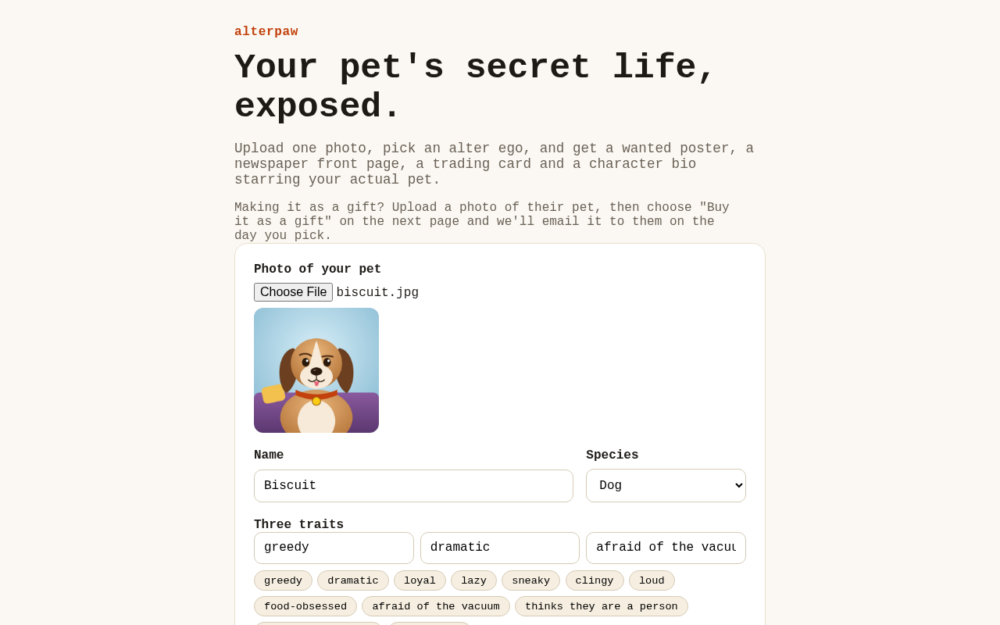
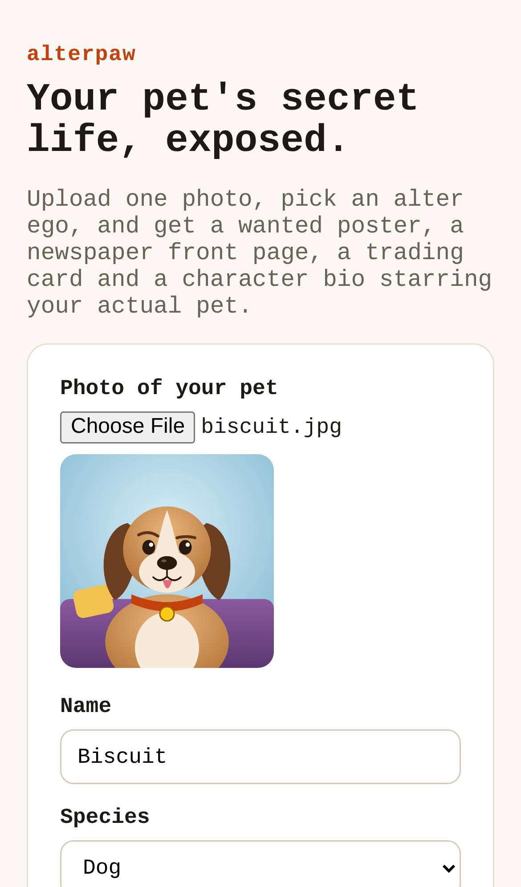
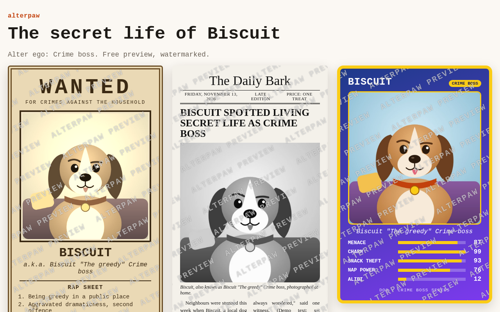
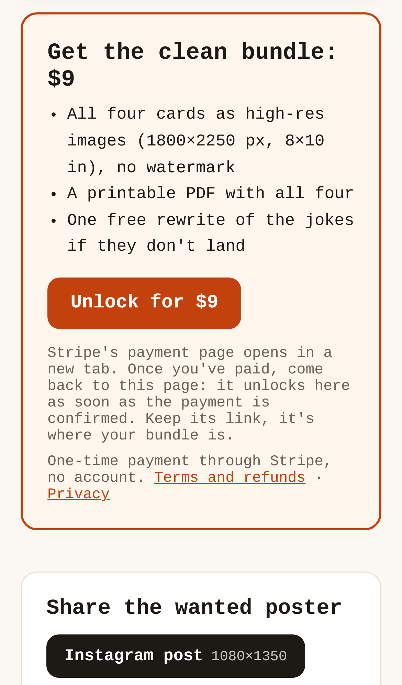
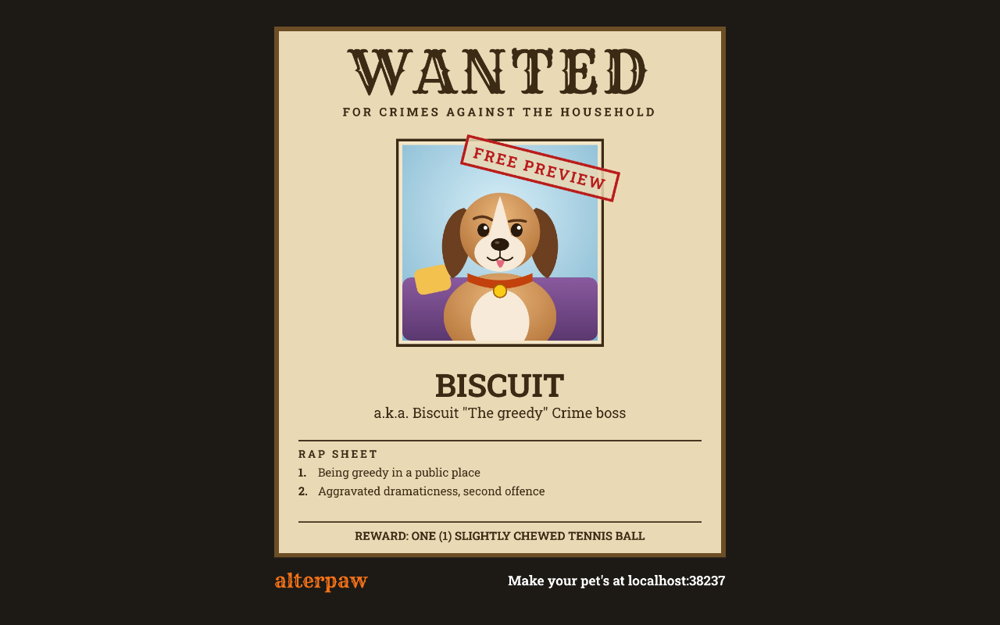
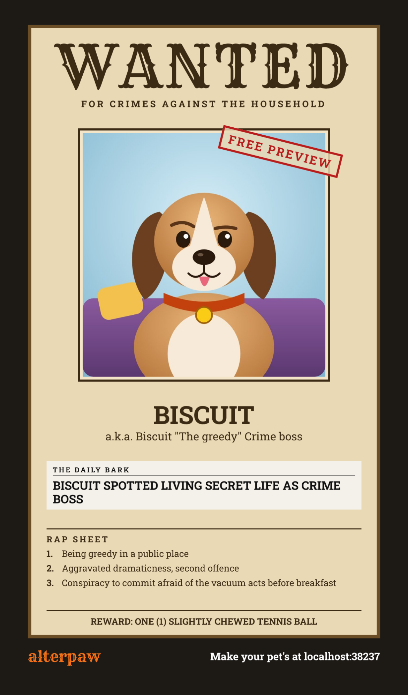

# alterpaw — your pet's secret life, as a funny wanted poster, newspaper and trading card

## Screenshots

The start page takes the core action's input: one photo (shrunk in the browser), a name, a species, three traits and an alter ego.

On a phone the form ends at the core action's button, and every page ends with the Privacy and Terms links.

Pressing "Reveal the secret life" makes the result: four cards built around the real photo, watermarked until paid for.

The Buy button ("Unlock for $9") shows because `STRIPE_PAYMENT_LINK` is set and goes to that link for this preview; without it the page shows a note instead.

The share link returns a 1080×1350 wanted-poster PNG drawn on the server with the pet's photo and a "make your pet's" footer.

The 1080×1920 Stories/Reels/TikTok version adds the front-page headline and the full rap sheet.

_Made by `npm run screenshots` (2026-11-13) with a drawn sample dog, at 1280×800 and as an iPhone 13. It runs the dev server with no database and no model call (the jokes are canned demo text). `STRIPE_PAYMENT_LINK` is the placeholder `https://example.com/pay`, and nothing is paid. No visit signal is sent: it isn't a production deployment, and Playwright is an automated browser. The UI font is the sandbox Chromium's fallback; phones and desktops use their own system font. The share images' footer says `localhost:<port>`; in production it shows the real domain._

**Live:** https://alterpaw.1426davejobs.workers.dev (a Cloudflare Worker since 2026-11-08; BUILD.md, "Deploy"). Launch checklist: [LAUNCH-READY.md](LAUNCH-READY.md).

For pet owners and the friends who buy them gifts, it turns one pet photo into a funny alter-ego bundle (wanted poster with rap sheet, newspaper front page, trading card, bio) for $9–$20 instead of a slow $17–$45 Etsy order.

- [Research](RESEARCH.md) — findings and sources
- [PRD](PRD.md)
- [Roadmap](ROADMAP.md)

Effort: Low · Confidence: Low

_Researched by the idea pipeline on 2026-10-13 ([original record](https://github.com/smithdavedesign/idea-factory/tree/main/ideas/alterpaw)); repo created on David's go-ahead 2026-10-13._
